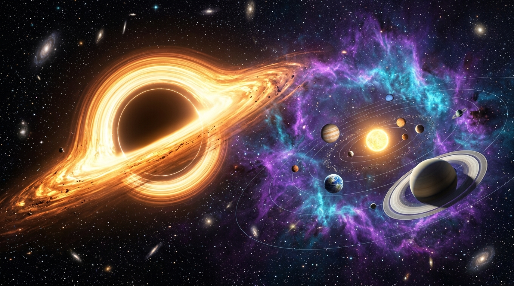

# 🌌 COSMOS ODYSSEY — 3D Interstellar Universe & Black Hole Explorer

[](https://threejs.org/)
[](https://developer.mozilla.org/en-US/docs/Web/API/WebGL_API)
[](https://developer.mozilla.org/en-US/docs/Web/API/Web_Audio_API)
[](https://github.com/abduqodirodiljonov)



**COSMOS ODYSSEY** — интерактивное 3D веб-приложение нового поколения для исследования космического пространства в реальном времени. Погрузитесь в детальную модель Солнечной системы, почувствуйте релятивистские гравитационные эффекты у горизонта событий сверхмассивной чёрной дыры **Гаргантюа** и совершайте межзвёздные прыжки в гиперпространство.

---

## ✨ Ключевые возможности

### 🪐 1. 3D Моделирование небесных тел
- **Солнце**: Процедурная текстура грануляции плазмы, пульсирующая солнечная корона и динамическое освещение всей системы.
- **Земля & Луна**: Фотореалистичные океаны и континенты, динамический слой облаков с независимым вращением, естественный спутник Луна.
- **Планеты земной группы & гиганты**: Меркурий, Венера, Марс, Юпитер с Большим Красным Пятном, Сатурн с полупрозрачными кольцами и щелью Кассини, ледяные гиганты Уран и Нептун.
- **Пояс астероидов**: Инстансинг 650+ независимых вращающихся астероидов между Марсом и Юпитером.

### 🕳️ 2. Сверхмассивная Чёрная Дыра «Гаргантюа»
- Фотонное кольцо гравитационного линзирования.
- Абсолютно чёрный горизонт событий, поглощающий фотоны.
- Сверхгорячий релятивистский аккреционный диск с вихревыми плазменными потоками и эффектом Доплера.

### 🚀 3. Режим космического пилота (Flight Mode)
- Управление исследовательским челноком от первого лица.
- Специфический HUD: авиагоризонт, индикаторы тяги, вектор скорости и щитов.
- Клавиши: **W/S** — тяга, **A/D** — рыскание, **Мышь** — тангаж и крен, **Shift** — форсаж.

### ⚡ 4. Гиперпространственный скачок (Warp Drive)
- Эффект разгона звезд в световые лучи с расширением угла обзора (FOV warp).
- Интегрированный звуковой эффект перехода на сверхсветовую скорость.

### 🎵 5. Процедурный космический аудио-синтезатор (Web Audio API)
- Работает автономно в любом браузере без внешних тяжелых mp3 файлов.
- Глубокий бинауральный суб-бас эмбиент на частоте 55 Гц (A1).
- Футуристичные звуковые сигналы бортового компьютера и телеметрии.

### 📊 6. Научная телеметрия и досье
- Карточки с физическими данными каждого объекта: радиус, масса, гравитация, температура поверхности, обитаемость.
- Измерители радиоактивности, искривления пространства и магнитного поля.

---

## 🎮 Управление

| Действие | Управление |
|---|---|
| **Вращение камеры** | Зажать левую кнопку мыши и двигать курсор |
| **Панорамирование** | Зажать правую кнопку мыши |
| **Приближение / Отдаление** | Колесо мыши |
| **Выбор планеты** | Клик по планете в 3D сцене или выбор из левого меню |
| **Ускорение времени** | Кнопки ❚❚ (пауза), 1x, 5x, 20x в нижней панели |
| **Гиперпространство** | Кнопка «ГИПЕРПРОСТРАНСТВО» в шапке |
| **Режим полета челнока** | Кнопка «РЕЖИМ ПИЛОТА» (W, A, S, D, Shift) |
| **Сделать снимок** | Кнопка «СНИМОК» (скачивает PNG с высоким качеством) |

---

## 🛠️ Стек технологий

- **WebGL & Three.js (r128)** — 3D визуализация, шейдеры и частицы.
- **OrbitControls** — плавное управление орбитальной камерой.
- **HTML5 Canvas** — процедурная генерация текстур планет и колец в памяти без задержек загрузки.
- **Vanilla CSS (Glassmorphism & HUD)** — темная футуристичная эстетика с эффектом размытия стекла и неоновой подсветкой.
- **Web Audio API** — модульный синтезатор частот и звуковых эффектов.

---

## 🚀 Быстрый запуск

1. Клонируйте репозиторий:
   ```bash
   git clone https://github.com/abduqodirodiljonov/test-github-html.git
   ```
2. Откройте `index.html` в любом современном браузере (Chrome, Edge, Firefox, Safari) — установка зависимостей не требуется!

---

*Разработано с душой для космических энтузиастов и исследователей звёзд.* 🚀
